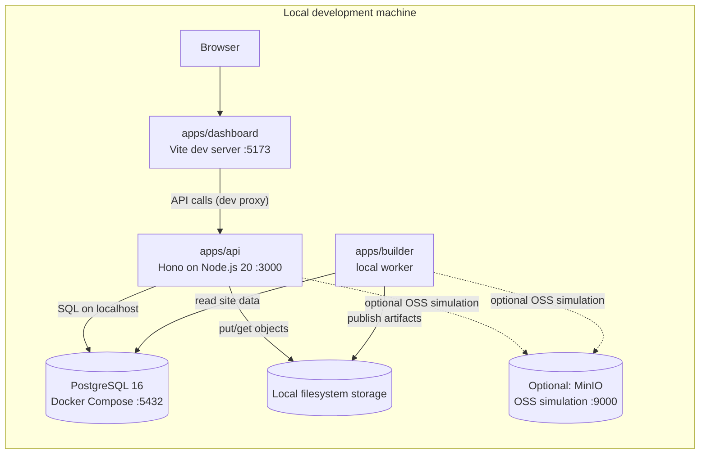
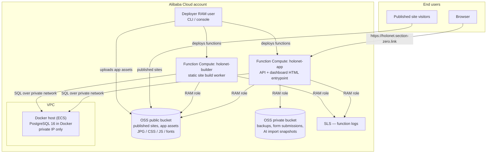
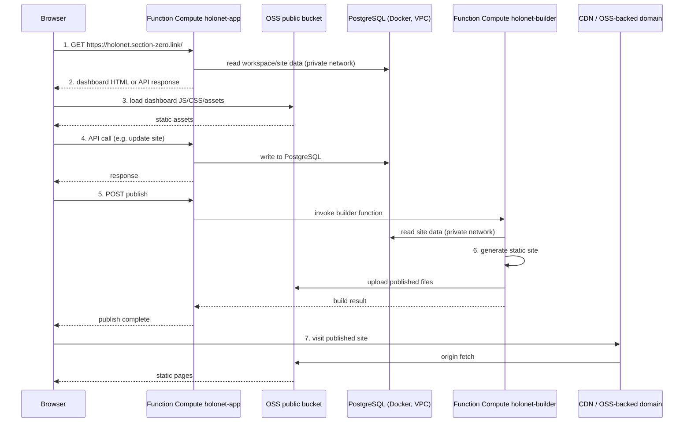

# Holonet — Architecture

> Status: scaffold phase. No business logic is implemented yet; entrypoints and interfaces are
> placeholders marked as such. This document describes the intended architecture in detail.

## Overview

Holonet is a security-first static website platform with AI-assisted website import,
template-based publishing, form handling, backups, and managed static hosting. The same
TypeScript code runs in two environments:

- **Local development** — a Node.js API, a React dashboard on a Vite dev server, PostgreSQL in
  Docker, and local filesystem storage (optionally MinIO as an OSS stand-in).
- **Production** — Alibaba Cloud Function Compute hosts the API/dashboard entrypoint and a
  separate build function; PostgreSQL runs in Docker on a Docker host inside a VPC; OSS stores all
  objects.

## Components

| Package                     | Responsibility                                                                                                                                                                                                                                           |
| --------------------------- | -------------------------------------------------------------------------------------------------------------------------------------------------------------------------------------------------------------------------------------------------------- |
| `apps/api`                  | Hono HTTP API with request-id/logging/security-headers/CORS/rate-limit middleware and typed Zod env config. Two entrypoints: `src/index.ts` (local Node server via `@hono/node-server`) and `src/function.ts` (Function Compute HTTP-triggered handler). |
| `apps/dashboard`            | React dashboard built with Vite. Calls the API; never talks to the database directly.                                                                                                                                                                    |
| `apps/builder`              | Static site build worker. Deployed as its own Function Compute function; loads site data, generates static files, publishes to OSS.                                                                                                                      |
| `packages/core`             | Shared constants (service name, public base URL) and domain identifier types (`WorkspaceId`, `SiteId`).                                                                                                                                                  |
| `packages/db`               | Drizzle ORM schema, migrations, and a PostgreSQL client factory.                                                                                                                                                                                         |
| `packages/storage`          | Storage abstraction with `local` (development/tests) and `oss` (production) backends.                                                                                                                                                                    |
| `packages/templates`        | Template manifests (Zod): identity, semver, default pages, theme and SEO defaults; ships three built-in templates (`professional-services`, `law-firm`, `accounting-firm`).                                                                              |
| `packages/static-generator` | `generateStaticSite()`: site snapshot → static site (index.html, page files, sitemap.xml, robots.txt, assets/styles.css, headers.json) with escaped, theme-driven HTML.                                                                                  |
| `packages/ai`               | AI import provider interfaces (`AiImportProvider`) plus a provider registry.                                                                                                                                                                             |
| `packages/security`         | Validation (Zod), rate limiting, audit logging, and security event utilities.                                                                                                                                                                            |

## Template system and static generation

### Template manifests (packages/templates)

- Templates are defined by **manifests** validated with Zod (`templateManifestSchema`):
  identity (`id`, `name`, semver `version`, `category`), default pages (path, title,
  description, initial blocks), **theme defaults** (colors, fonts), and **SEO defaults**
  (`titleTemplate`, description, author).
- Every template block is validated against the block type schemas in `@holonet/core`
  (untrusted data, rule 17).
- **Built-in templates:** `professional-services`, `law-firm`, `accounting-firm` — each ships
  the seven default pages (home, about, services, team, contact, privacy-policy,
  terms-of-use) with ready-made blocks and a distinct theme and SEO profile.
- Persistence: `templates` + `template_versions` rows store the manifest JSONB; the generator
  re-validates whatever manifest it is handed, wherever it came from.

### Static generation (packages/static-generator)

- `generateStaticSite(input: HolonetSiteSnapshot)` → `GeneratedSiteOutput` with **key/content
  pairs** ready for upload under `sites/{siteId}/releases/{deploymentId}/…` in OSS.
- Output always includes: `index.html` (the `/` page), one directory-style `index.html` per
  page, `sitemap.xml`, `robots.txt`, `assets/styles.css` (responsive, theme-driven CSS
  variables), and `headers.json` (recommended security headers + cache rules for the
  CDN/OSS layer).
- Generated HTML includes meta title/description, canonical URL, Open Graph tags, site
  navigation, footer, and contact-form markup when a `contact_form` block exists.
- All block props and titles are HTML-escaped at render time (rule 17); unknown block types
  render nothing.
- The builder worker (apps/builder) will feed DB-loaded site snapshots through the generator
  and upload the output via `packages/storage`.

## Local development architecture

| Piece                        | How it runs                                                                                                                                         |
| ---------------------------- | --------------------------------------------------------------------------------------------------------------------------------------------------- |
| API (`apps/api`)             | Node.js 20 process via `pnpm dev` — Hono app served by `@hono/node-server` on port 3000.                                                            |
| Dashboard (`apps/dashboard`) | Vite dev server on port 5173; proxies API calls to the local Node API.                                                                              |
| PostgreSQL                   | Docker Compose (`infra/docker/docker-compose.yml`), port 5432, credentials matching the local `DATABASE_URL`.                                       |
| Storage                      | Local filesystem backend (`packages/storage`, `kind: 'local'`) rooted at a workspace-local directory.                                               |
| Optional MinIO               | S3-compatible object server in Docker (port 9000) that simulates OSS, so the OSS code path can be exercised locally without touching Alibaba Cloud. |
| Builder (`apps/builder`)     | Runs as a local worker (`pnpm --filter @holonet/builder dev`), reading from PostgreSQL and writing artifacts to local storage.                      |



Development state: PostgreSQL data persists in a Docker volume; all object data lives on the local
disk; no Alibaba Cloud resources are required to develop or test.

## Production architecture

| Piece                      | Alibaba Cloud service                                                             |
| -------------------------- | --------------------------------------------------------------------------------- |
| API + dashboard entrypoint | Function Compute function `holonet-app` (`FC_FUNCTION_NAME_APP`)                  |
| Static site builds         | Separate Function Compute function `holonet-builder` (`FC_FUNCTION_NAME_BUILDER`) |
| Metadata database          | PostgreSQL 16 running in Docker on a Docker host (ECS) inside the VPC             |
| Public objects             | OSS public bucket: JPG, CSS, JS, fonts, published static websites, app assets     |
| Non-public objects         | OSS private bucket: backups, form submissions, AI import snapshots                |
| Deployment identity        | Dedicated RAM user (AccessKey pair only in the deployer's environment)            |
| Function identity          | RAM role assumed by Function Compute, granting OSS and SLS log access             |
| Public entry               | Custom domain https://holonet.section-zero.link                                   |

- The `holonet-app` function serves the **dashboard HTML** (from the OSS-stored SPA bundle) and
  the **API** behind the custom domain.
- The `holonet-builder` function performs static site builds: it reads site data from PostgreSQL,
  generates files via `packages/static-generator`, and uploads them to OSS.
- PostgreSQL runs in Docker on a Docker host inside the VPC. Function Compute reaches it over the
  VPC **private network** (`VPC_ID`/`VSWITCH_IDS`/`SECURITY_GROUP_ID`); the database has no public
  endpoint (explicit constraints in docs/infrastructure.md).
- All object data is in OSS: public resources in the public bucket, everything else in the private
  bucket.
- Deployment is performed by a dedicated **RAM user**; the running functions use a **RAM role**
  with least-privilege OSS and SLS access (templates in `infra/alibaba/`).
- The custom domain https://holonet.section-zero.link fronts the platform; published sites are
  served from the OSS public bucket (optionally via CDN — see future upgrade paths).



## Request flow

1. A browser visits https://holonet.section-zero.link.
2. Function Compute (`holonet-app`) returns the dashboard HTML or an API response.
3. Static assets (dashboard JS/CSS and other app assets) are loaded from the OSS public bucket.
4. API calls read from and write to PostgreSQL over the VPC private network.
5. A publish action invokes the `holonet-builder` Function Compute function.
6. The builder loads the site data, generates the static site, and uploads the files to the OSS
   public bucket.
7. The published site is served from OSS (or a CDN/OSS-backed domain).



## Key decisions

1. **Function-first entrypoints.** The API, builder, and background jobs expose small entrypoints
   (local server wrapper + FC handler) so the same code runs locally and on Function Compute.
2. **Stateless compute.** Function Compute instances are ephemeral; all durable state lives in
   PostgreSQL and OSS.
3. **Database is infrastructure.** Function Compute cannot host a persistent PostgreSQL database;
   PostgreSQL runs in Docker on a host inside the VPC (see docs/infrastructure.md).
4. **Source-based internal packages.** Internal packages are consumed directly from `src/` via
   workspace links (`workspace:*` + `exports` pointing at `src/index.ts`); no internal publishing
   step.
5. **Tenant isolation by workspace.** Every tenant-scoped table carries a `workspaceId`; every API
   route is workspace-scoped; every storage key is workspace-prefixed (rule 18).
6. **Untrusted content.** Imported websites and AI output are treated as untrusted data and
   sanitized at the generation boundary (rule 17).

## AI import providers (packages/ai/src/provider.ts)

The import pipeline is fetch → analyze → draft. Analysis is pluggable behind one interface:

```
AIProvider.analyzeWebsiteImport(input: ImportAnalysisInput): Promise<ImportAnalysisOutput>
```

**Providers:**

| Provider         | Selection            | Behavior                                                                                                                                                                                                                                                    |
| ---------------- | -------------------- | ----------------------------------------------------------------------------------------------------------------------------------------------------------------------------------------------------------------------------------------------------------- |
| `ManualProvider` | default              | Offline: parses fetched HTML into a conservative structured draft (title, headings, text snippets, navigation, images, contact details, social links, template suggestion). No external calls, no code execution.                                           |
| `HttpAIProvider` | `AI_PROVIDER=http`   | Calls an OpenAI- or Qwen-compatible chat-completions endpoint (`AI_ENDPOINT`, `AI_API_KEY`, `AI_MODEL`) with a versioned, structured prompt (`PROMPT_TEMPLATE_VERSION = holonet-import-v1`), `response_format: { type: json_object }`, and low temperature. |
| `OllamaProvider` | `AI_PROVIDER=ollama` | PLACEHOLDER for a local Docker-hosted model. Fails fast; the pipeline falls back to manual, so Ollama is never required.                                                                                                                                    |

**Guarantees:**

- **Zod-validated output.** `importAnalysisOutputSchema` is the single contract
  (businessName, siteType, suggestedTemplate, designTokens, navigation, pages with block
  suggestions, contact, socialLinks, warnings). HttpAIProvider rejects any response that does
  not parse to the schema; the draft creator re-validates before touching the database.
- **Manual fallback.** `analyzeWithFallback` catches provider failures (network, auth, invalid
  JSON output) and falls back to `ManualProvider`, recording `fallbackFrom` on the analysis so
  the import never loses fetched content.
- **Versioned prompts.** The prompt template version is embedded in the prompt and stored on
  `ai_analyses.prompt_template_version` (with `provider` and `model`) so any output can be
  traced to the exact prompt that produced it.
- **Untrusted text.** All extracted/AI text is sanitized (control characters removed, whitespace
  collapsed) and length-limited by the schema; nothing from the fetched site or the AI is
  executed.

**Draft creation** (`apps/api/src/lib/import-draft.ts`):

1. Validate the analysis (Zod) — invalid output creates nothing.
2. Use `suggestedTemplate` only when it matches a known manifest (`law-firm`,
   `accounting-firm`, `professional-services`); create/link the `template_versions` row and set
   `sites.templateVersionId`.
3. Set the site status to `draft` (a published site is never auto-unpublished — its imported
   pages are drafts regardless).
4. Write `design_tokens` (name `imported`) from `analysis.designTokens`.
5. Create draft pages (unique paths, `status: 'draft'`) and blocks (section type allowlist →
   validated via `validateBlock`, degrading to `text_section` on any mismatch).
6. Never creates deployments and never touches `current.json` — imports cannot publish.

## Future upgrade paths

| Today                                 | Planned upgrade                                  | Why                                                                                                 |
| ------------------------------------- | ------------------------------------------------ | --------------------------------------------------------------------------------------------------- |
| PostgreSQL in Docker on an ECS host   | Managed PostgreSQL (ApsaraDB RDS for PostgreSQL) | Managed backups, HA, patching — same private VPC connectivity, no application change                |
| Direct OSS-backed domain / FC domain  | CDN (Alibaba Cloud CDN/DCDN)                     | Edge caching, TLS termination, DDoS protection for the dashboard and published sites                |
| Direct function invocation for builds | Redis queue (ApsaraDB for Redis / Tair)          | Decouples publisher from builder; adds retries, backpressure, and job observability                 |
| Docker host on a single ECS           | Kubernetes (ACK)                                 | Orchestrates builders, workers, and the database with declarative infrastructure                    |
| Manual billing                        | Merchant-of-record payment integration           | Subscriptions and invoicing handled by a merchant of record (e.g. Paddle, Stripe, Lemon Squeezy)    |
| External AI provider (`AI_PROVIDER`)  | Internally hosted AI model                       | A self-hosted model (e.g. vLLM-served LLM on GPU ECS inside the VPC) keeps imported data in-network |

## Placeholders and assumptions

Open questions (marked `PLACEHOLDER` in the relevant files) are tracked in
docs/infrastructure.md: FC HTTP-trigger signature, deployment tooling, Docker host specifics,
MinIO add-on packaging, and the OSS SDK choice.
