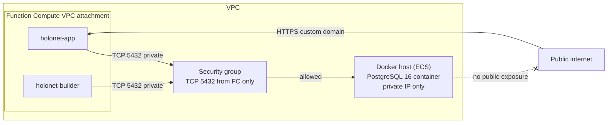

# Holonet — Infrastructure

## Local development infrastructure

| Piece          | How it runs                                                                                                                                |
| -------------- | ------------------------------------------------------------------------------------------------------------------------------------------ |
| API            | Node.js 20 process (`pnpm dev`), port 3000 — `apps/api`.                                                                                   |
| Dashboard      | Vite dev server, port 5173 — `apps/dashboard`.                                                                                             |
| PostgreSQL     | Docker Compose (`infra/docker/docker-compose.yml`), port 5432, volume-backed data, local development credentials matching `.env.example`.  |
| Storage        | Local filesystem backend (`packages/storage`, `kind: 'local'`); all objects live on the local disk.                                        |
| Optional MinIO | S3-compatible server that simulates OSS locally, so the OSS code path in `packages/storage` can be exercised without Alibaba Cloud access. |

> **PLACEHOLDER — MinIO add-on.** A Docker Compose add-on for MinIO (port 9000) and the
> corresponding storage backend wiring is planned; until then MinIO can be started manually
> (`minio server` or `docker run minio/minio`) against the same S3-compatible interface.

## Production infrastructure (Alibaba Cloud)

### Function Compute

- **`holonet-app`** — hosts the Holonet API and serves the dashboard HTML entrypoint. HTTP
  trigger bound to the custom domain https://holonet.section-zero.link. Node.js 20 runtime,
  VPC-attached, runs under the Holonet RAM role.
- **`holonet-builder`** — a separate function for static site builds. Invoked by `holonet-app` on
  publish; higher memory and timeout; same VPC attachment and RAM role.

### PostgreSQL (Docker inside the VPC)

- PostgreSQL 16 runs **in Docker on a Docker host (ECS) inside the VPC**.
- Function Compute accesses PostgreSQL over the **VPC private network** (FC VPC attachment:
  `VPC_ID`, `VSWITCH_IDS`, `SECURITY_GROUP_ID`).
- Explicit constraints:
  1. **Function Compute cannot run a persistent PostgreSQL database.** FC instances are ephemeral,
     stateless, and auto-scaled; they offer no durable local storage or stable long-lived TCP
     listeners. Treat every FC invocation as possibly running on a fresh instance.
  2. **The database must be deployed in Docker on a host reachable by Function Compute** — today
     that is an ECS instance in the same VPC (managed PostgreSQL is a future upgrade path).
  3. **The database must not be exposed publicly.** The Docker host has no public route to the
     database port; the security group allows TCP 5432 only from the FC attachment CIDR;
     credentials come from the environment, never from Git.
- Backups: `infra/scripts/backup-db.sh` (pg_dump) → upload to the OSS private bucket.

### OSS

- **Public bucket** (`OSS_PUBLIC_BUCKET`) — public resources: JPG, CSS, JS, fonts, published
  static websites, and app assets. Public-read policy template:
  `infra/alibaba/oss/oss-bucket-policy.example.json`.
- **Private bucket** (`OSS_PRIVATE_BUCKET`) — non-public resources: database backups, form
  submissions, AI import snapshots. No public read.

### RAM

- **RAM user (deployment)** — a dedicated least-privilege user performs deployments (Function
  Compute updates, OSS uploads of app assets). Its AccessKey pair lives only in the deployer's
  environment; it is never committed to Git and never appears in `.env.example`.
- **RAM role (Function Compute)** — `FC_ROLE_ARN`, assumed by both functions. Grants only what
  the functions need: object access to the two Holonet OSS buckets and log writes to SLS. Policy
  template: `infra/alibaba/ram/holonet-fc-role-policy.example.json`.

### Logs

Function logs are written to SLS through the RAM role; no AccessKeys are embedded in the
functions.

### Custom domain

- https://holonet.section-zero.link is bound to the `holonet-app` HTTP trigger (dashboard + API).
- Published sites are served from the OSS public bucket on an OSS-backed domain; later phases can
  add a CDN in front of it (future upgrade path).

### Network diagram

## Secrets policy

- **No secrets in Git.** No AccessKeys, passwords, database credentials, or private keys are ever
  committed — not in code, not in docs, not in config templates (rules 10/11).
- Configuration comes from environment variables; `.env.example` holds placeholders only.
- Production function environment variables are injected at deploy time by the deployer (RAM
  user).
- `AUTH_SECRET` in `.env.example` is a placeholder that must be replaced before any non-local
  deployment.

## Local helper scripts (`infra/scripts`)

| Script            | Purpose                                                                             |
| ----------------- | ----------------------------------------------------------------------------------- |
| `dev.sh`          | Start PostgreSQL via Docker Compose, then run `pnpm dev`.                           |
| `db-up.sh`        | Start the local database container and wait until it is healthy.                    |
| `db-down.sh`      | Stop the local database container (keeps the data volume).                          |
| `db-psql.sh`      | Open a psql shell in the local database container.                                  |
| `db-backup.sh`    | pg_dump (plain SQL, gzip) of the local database → `backups/database/`.              |
| `db-restore.sh`   | Restore a backup file into the local database.                                      |
| `backup-db.sh`    | `pg_dump` custom-format backup using `DATABASE_URL`.                                |
| `restore-db.sh`   | `pg_restore` from a backup file using `DATABASE_URL`.                               |
| `deploy-check.sh` | Verify tooling (always) and production environment variables (with `--production`). |

## Configuration templates (`infra/alibaba`)

| Template                                  | Purpose                                                                           |
| ----------------------------------------- | --------------------------------------------------------------------------------- |
| `fc/fc-config.example.json`               | Function Compute service + function layout (app + builder), VPC config, RAM role. |
| `oss/oss-bucket-policy.example.json`      | Public-read policy for the public bucket.                                         |
| `ram/holonet-fc-role-policy.example.json` | Least-privilege OSS policy for the FC execution role.                             |

All values are placeholders; real values come from environment variables.

## Placeholders and assumptions

- **PLACEHOLDER — FC HTTP trigger signature.** `apps/api/src/function.ts` assumes Function
  Compute v3-style HTTP triggers passing a Web `Request` and expecting a `Response`. Confirm the
  chosen FC runtime/trigger before deployment and update `infra/alibaba/README.md` (rule 16).
- **PLACEHOLDER — deployment tooling.** Serverless Devs (`s` CLI), Alibaba Cloud CLI, or
  console-based deployment — finalized in the deployment phase (see docs/deployment.md).
- **PLACEHOLDER — Docker host specifics.** The ECS instance size/image for the Docker host is
  decided during the deployment phase.
- **PLACEHOLDER — OSS SDK.** The OSS backend in `packages/storage` will use the official Alibaba
  Cloud OSS Node.js SDK (or signed HTTP calls); the choice is documented when implemented.
- **PLACEHOLDER — MinIO add-on.** Compose packaging for the optional local OSS simulation.
